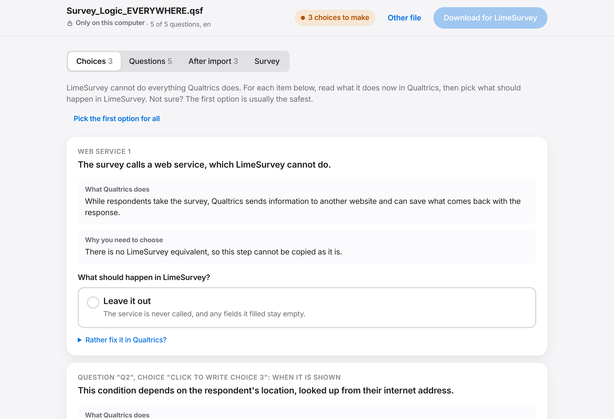
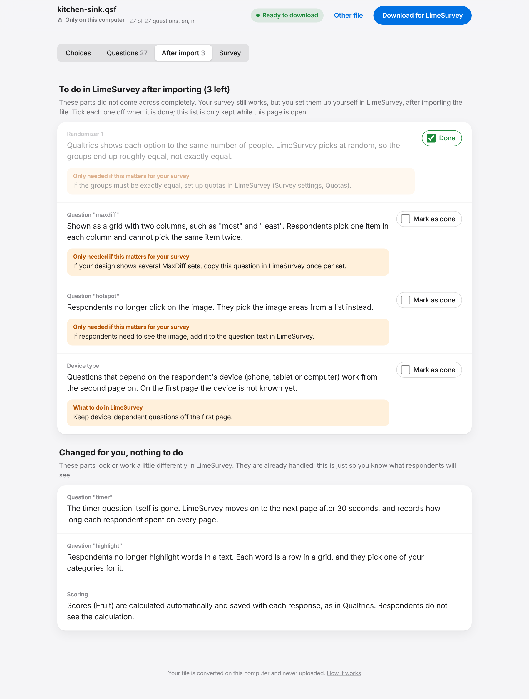
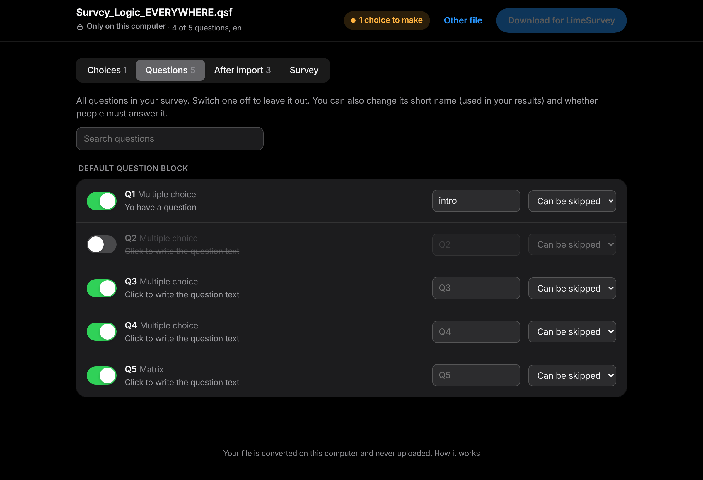
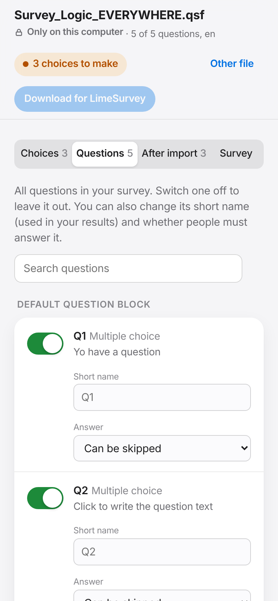

<h1 align="center">Qualtrics to LimeSurvey</h1>

<p align="center">
  Move a Qualtrics survey to LimeSurvey and keep its logic: display logic, skip logic, branches, end-of-survey
  elements, randomizers, embedded data, piped text, loop &amp; merge, carry forward, validation, default answers,
  scoring, quotas and translations.
</p>

<p align="center">
  <a href="https://peterslijkhuis.github.io/QualtricsToLimeSurvey/"></a>
</p>

<p align="center">
  
</p>

### Your file stays on your computer

The converter opens in your web browser, but all the work happens on your own computer. The survey file is not
uploaded, sent or stored anywhere. You can check it: once the page has loaded, switch off your internet connection
and it keeps working.

## Use it

1. **Get your file from Qualtrics.** Open the survey, click **Tools**, then **Import/Export**, then **Export survey**.
   A file ending in `.qsf` is saved on your computer.
2. **Open it in the [converter](https://peterslijkhuis.github.io/QualtricsToLimeSurvey/).** Click the box and pick
   the file, or drag the file onto it.
3. **Choices.** Some things Qualtrics does have no exact LimeSurvey equivalent. For each one the page explains, in
   plain words, what Qualtrics does, why you need to choose, and what each option changes for respondents. Pick one
   for each item, or click **Pick the first option for all**. You can change a choice at any time. If you would
   rather fix it in Qualtrics, each item also says what to change there.
4. **Questions.** Switch a question off to leave it out, change its short name (used in your results), or choose
   whether people must answer it. **Survey** lets you change the title.
5. **Download for LimeSurvey** turns on when every choice is made. In LimeSurvey choose **Create survey**,
   **Import**, and pick the downloaded `.lss` file.
6. **After import.** A to-do list of things to set up yourself in LimeSurvey (with where to click), and a list of
   things that were changed for you and need nothing from you. Tick each to-do off as you go.

<p align="center">
  
</p>

<p align="center">
  
</p>

<p align="center">
  
  
</p>

Target: LimeSurvey 6.x (the file also imports into 7.x).

## Publish on GitHub Pages

Repository **Settings > Pages > Build and deployment**: source "Deploy from a branch", branch `main`, folder `/ (root)`.
The page is `index.html`; the converter is `src/qsf2lss.js`. There is no build step.

## Develop

```
npm test                 # node --test, no dependencies
python3 -m http.server   # then open http://localhost:8000
```

Every push to `main` or `development` and every pull request runs the tests on Node 18, 22 and 24, then imports each
converted fixture into LimeSurvey 6.17 and fails on any import warning or ExpressionScript syntax error
(`.github/workflows/test.yml`, using `test/limesurvey/CheckLssCommand.php`).

`convert(qsfTextOrObject, { choices, edits, title })` returns `{ lss, problems, decided, notes, items, stats }`.
Each problem has an `id`, `qualtrics` (what Qualtrics does), `why` (why a choice is needed) and `options` (each with a `label` and its `impact`); pass `choices: { [id]: option.key }` to resolve it. `edits` is
`{ QID: { skip, code, mandatory } }`. `lss` stays empty while unresolved problems remain. It works the same in Node and
the browser.

## How Qualtrics maps to LimeSurvey

### Structure

| Qualtrics | LimeSurvey |
|---|---|
| Block | Question group (one per page; page breaks split a block into several groups) |
| Block shown twice in the flow | Shown once, at its first position (note) |
| Question export tag (`DataExportTag`) | Question code (letters and digits only, made unique) |
| Recode values | Answer and subquestion codes, so data keeps the same codes |
| Survey languages | Survey languages, with question, choice and answer translations |
| Back button, progress bar, save and continue, anonymize, ballot-box stuffing, response summary, table of contents | Matching survey settings |

### Question types

| Qualtrics | LimeSurvey |
|---|---|
| Text / graphic (DB) | Text display (X) |
| Multiple choice, single answer (vertical, horizontal, columns) | List radio (L), with columns |
| Multiple choice, dropdown or select box | List dropdown (!) |
| Multiple choice, multiple answer | Multiple choice (M); exclusive choices become "exclude all others" |
| Net Promoter Score | List radio 0 to 10 |
| Choice with a text box | The first becomes "Other"; further ones become a short text question shown when the choice is picked (note) |
| Matrix single answer, bipolar, dropdown, drag and drop, carousel | Array (F); bipolar statements use `left\|right` |
| Matrix multiple answer | Array numbers (:) with checkboxes |
| Matrix text entry | Array texts (;) |
| Matrix constant sum | Array numbers (:) without the sum check (note) |
| Side by side | One array question per column, same rows (note) |
| Text entry single line, multi line, essay | Short (S), long (T), huge (U) text |
| Text entry with number validation | Numerical input (N) with min and max |
| Text entry with date validation | Date (D) |
| Text entry form | Multiple short text (Q) |
| Slider, bar, star | Multiple numerical (K) as sliders |
| Constant sum | Multiple numerical (K) with "total must equal" |
| Rank order | Ranking (R) |
| File upload | File upload (\|) |
| Timing | Removed; LimeSurvey page timings are switched on (note). A maximum time becomes a page time limit that moves on |
| Hot spot | Multiple choice (on/off regions) or Array like/dislike (note: the image is not clickable) |
| Heat map with regions, highlight (HL) | Array per region or word (note) |
| Matrix MaxDiff | Array by column, best and worst, with a check that they differ |
| Meta info, captcha | Removed; LimeSurvey settings named in the note |
| Signature, drawing, heat map without regions, pick group rank, drill down, tree select, gap analysis, map, screen capture, video, conjoint, matrix profile | **Choice**: replace with file upload (where it fits), long text or text display, or leave out |

### Behaviour

| Qualtrics | LimeSurvey |
|---|---|
| Display logic (question), in-page display logic | Question relevance equation |
| Display logic on a choice of a multiple-answer question or matrix row | Subquestion relevance |
| Display logic on a choice of a single-answer question | Hidden multiple choice filter + `array_filter`, set just before the page |
| AND / OR, logic sets | `and` / `or`; AND binds tighter than OR, as in Qualtrics |
| Selected / not selected, displayed / not displayed, equal, not equal, greater/less than, empty, contains, matches regex | ExpressionScript comparisons (unanswered or hidden questions count as not selected, like Qualtrics) |
| Skip logic to end of block or a later question | `!(condition)` on the skipped questions |
| Skip logic to end of survey, End of survey element inside a branch | `!(condition)` on every later question and group |
| Branch | Group relevance on every group inside the branch |
| Embedded data with a value (text, piped text, `$e{ }` math) | Hidden variable plus an equation that assigns it at that point of the flow |
| Embedded data without a value | Hidden variable filled from the survey link (`?field=value`) |
| Randomizer showing all blocks | Group randomization |
| Randomizer showing a subset (blocks or embedded data) | Random draw per element, kept on page reload; elements shown by rank |
| Randomizer "evenly present" | Plain random selection (note: use quotas for exact balance) |
| Loop & merge (static, over choices, over a number) | Block repeated per iteration, with `${lm://Field/n}` filled in and in-loop logic per iteration |
| Carry forward choices | Same codes; rows/choices filtered by relevance or `array_filter`; question hidden when nothing is carried |
| Choice randomization | Random answer/subquestion order (pinned choices move: note) |
| Block question randomization | Random question order within the page |
| Force / request response | Mandatory / soft mandatory |
| Min/max choices, character limits, email/phone/zip/number/date/text-only validation | Min/max answers, max characters, regular expressions, number limits |
| Custom validation | `em_validation_q` with its message |
| Default choices | Default answers |
| End of survey redirect | End URL with automatic redirect; different redirects per path become one conditional URL |
| Quotas (question = choice, AND across questions, OR within one) | LimeSurvey quotas with the same limit and end action |
| Scoring categories and per-choice points | Hidden score variables summed at the end; `${gr://...}` and branches on a score work |
| Device type condition | Hidden device variable filled from the browser |
| Embedded fields ResponseID, SurveyID, dates, language | `SAVEDID`, `SID`, `date()`, `LANG` |
| Authenticator | Blocks kept, survey left open (note: switch on a participant list to require login) |
| Panel fields (first name, last name, email, external reference) | Participant fields `TOKEN:FIRSTNAME` etc. (note: add a participant list) |

### Piped text

| Qualtrics | LimeSurvey |
|---|---|
| `${q://QIDx/ChoiceGroup/SelectedChoices}` | Selected answer text, or the list of ticked options |
| `${q://QIDx/ChoiceTextEntryValue}` and `/n` | Entered text, form field, or "other" text |
| `${q://QIDx/ChoiceNumericEntryValue/n}` | Value of that row |
| `${q://QIDx/QuestionText}`, `SelectedChoicesRecode`, `SelectedChoicesCount`, `SelectedAnswerRecode/n` | `.question`, codes, `countif`, row value |
| `${e://Field/name}` | The hidden variable |
| `${lm://Field/n}`, `${lm://CurrentLoopNumber}` | Filled in per loop iteration |
| `${rand://int/a:b}`, `${date://CurrentDate/...}` | `rand(a, b)`, `date(...)` |
| `$e{ ... }` math | ExpressionScript arithmetic |
| `${gr://SC_x/Score}` | The score variable |
| GeoIP, web service, custom JavaScript, subset question randomization, quotas on other quotas or complex logic | **Choice**, with options and what to change in Qualtrics |

## Checked against LimeSurvey

Every sample in `test/fixtures` was imported into LimeSurvey 6.17 with no import warnings and no ExpressionScript
syntax errors, and `kitchen-sink.qsf` was answered through in the browser to confirm logic, branches, loops,
randomizers, piping and embedded data behave as in Qualtrics. `households.qsf` comes from
[JHUCities/qretools](https://github.com/JHUCities/qretools) (MIT licence).
